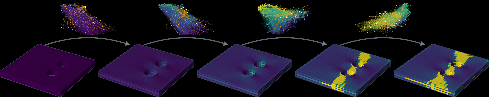

# graph-transformer-damage-propagator

[](https://www.python.org/downloads/)
[](https://pytorch.org/)
[](LICENSE)

<p align="center"></p>

**Paper:** "Autoregressive Graph Transformers with Hybrid Local–Global Attention for Progressive Damage Evolution in Composite Laminates"
**Authors:** Luca Patrignani, Silvestre T. Pinho | Imperial College London

An autoregressive graph transformer that predicts the evolution of the matrix cracking failure index and of the corresponding damage variable in CFRP laminates. This repository contains the pipeline from parametric Abaqus decks to graph datasets, the training, testing and rollout code, and the scripts behind the results and figures of the paper.

## Citation

```bibtex
@article{patrignani2026autoregressive,
  title={Autoregressive graph transformers with hybrid local--global attention for progressive damage evolution in composite laminates},
  author={Patrignani, Luca and Pinho, Silvestre T},
  journal={Computer Methods in Applied Mechanics and Engineering},
  year={2026},
  publisher={Elsevier}
}
```

## Repository structure

```
graph-transformer-damage-propagator/
├── environment.yml
├── src/
│   ├── preprocessing/         # decks, Abaqus runs, ODB extraction, graph datasets
│   └── gtp/                   # model, training, evaluation (python -m src.gtp)
├── scripts/                   # Abaqus drivers and dataset recipes
├── tools/                     # analysis and figure scripts
│   └── paper_analysis/        # scripts behind specific numbers of the paper
├── Subroutine/                # Abaqus user subroutine
├── data/                      # decks of the single-ply and extrapolation studies
└── results/                   # trained models of the paper and their test results
```

## Requirements

- Linux, Python 3.10, and the packages in [`environment.yml`](environment.yml)
- An NVIDIA GPU for training (inference also runs on the CPU)
- Abaqus 2024, only to generate new data (meshing, simulations, ODB extraction)

## Installation

```bash
git clone https://github.com/EngLPat/graph-transformer-damage-propagator.git
cd graph-transformer-damage-propagator
conda env create -f environment.yml
conda activate gtp
python -c "import torch, torch_geometric, torch_scatter; print(torch.__version__, torch.cuda.is_available())"
```

`environment.yml` installs PyTorch 2.4.0 with CUDA 11.8. Its header lists the changes
for CPU-only machines, CUDA 12.1 and Linux aarch64.

## Data

The datasets are archived on Zenodo together with this code:
https://doi.org/10.5281/zenodo.23560514. Each archive unpacks from the repository root into the
layout below, e.g. `tar -xzf laminate.tar.gz`.

| Dataset | Content |
|---|---|
| `singleply` | single 90° ply, 200 simulations |
| `laminate` | [45/-45/0/90]s laminate, 400 simulations |
| `laminate_yt_variability` | the same laminate with the transverse tensile strength Y_T sampled in [51, 69] MPa |
| `extrap_<case>` | geometries outside the training distribution (see below) |

Each dataset lives under its own name:

```
data/raw/<dataset>/geometry/plate_XXX.inp        Abaqus decks
data/raw/<dataset>/simulations/plate_XXX/        Abaqus runs (ODB files are not distributed)
data/processed/<dataset>/<dataset>_dmgstate_dataset_uniform_dt0.01.pt     graph dataset
```

## Abaqus user subroutine

The simulations use a USDFLD user subroutine (LaRC05 failure criteria and continuum damage) for
ply failure and damage. It is distributed in compiled form for Abaqus 2024 on Linux, in two
equivalent builds:

- `Subroutine/libstandardU.so`, a user subroutine library that needs no Fortran compiler. The
  scripts use it: each simulation folder gets an `abaqus_v6.env` that points Abaqus to
  `Subroutine/`.
- `Subroutine/usdfld3d.o`, an object file for installations with the Intel Fortran compiler,
  passed with Abaqus's `user=` option.

The material constants are read from the decks.

## Usage

All commands run from the repository root.

### 1. Decks and simulations

```bash
# Laminate: decks (Abaqus/CAE meshes each plate), then the simulations
python -m src.preprocessing.generate_cohesive_laminate_uniform \
    --n 400 --seed 42 --layup 45,-45,0,90 --ply-thickness 0.375 --elem-size 0.90 \
    --sym-bc --direct-bc --study laminate
MAXP=2 CPUS=24 bash scripts/run_laminate_simulations.sh

# Single ply and Y_T variability: decks, simulations and dataset in one script
bash scripts/make_singleply_dataset.sh
bash scripts/make_laminate_yt_variability_dataset.sh
```

### 2. Graph dataset

```bash
python -m src.preprocessing.build_cohesive_dataset \
    --study laminate --include-damage-feature --resample-dt 0.01
```

The dataset holds one graph per pair of consecutive frames, resampled to a uniform
pseudo-time step. Nodes are ply elements; the node features are listed in the
docstring of [`build_cohesive_dataset.py`](src/preprocessing/build_cohesive_dataset.py).

### 3. Training

```bash
# Laminate, two GPUs
torchrun --nproc_per_node=2 --standalone -m src.gtp --mode train \
    --dataset data/processed/laminate/laminate_dmgstate_dataset_uniform_dt0.01.pt \
    --num-layers 9 --hidden-dim 128 --attention-freq 4 --dropout 0.00164 \
    --batch-size 8 --learning-rate 0.00019068 --weight-decay 2.5e-5 \
    --rate-cap 0 --epochs 400 --two-stage --output-dir results/laminate

# Single ply, one GPU
python -m src.gtp --mode train \
    --dataset data/processed/singleply/singleply_dmgstate_dataset_uniform_dt0.01.pt \
    --num-layers 6 --hidden-dim 128 --attention-freq 2 --dropout 0.158 \
    --batch-size 4 --learning-rate 3.72e-4 --weight-decay 1e-5 \
    --rate-cap 10 --epochs 800 --two-stage --output-dir results/singleply
```

The attention ablations add `--no-local-attention-enabled`, `--no-global-attention-enabled`
or `--no-attention`; `--alpha-global` sets the weight of the global-attention branch
(default 0.2); `--seed` sets the initialisation and dropout (the train/validation/test
split, 70/15/15 by simulation, does not change with it). `--resume-from
<run>/best_models/last_checkpoint.pt` continues a run.

| Environment variable | Effect |
|---|---|
| `GTP_STAMPED_CKPTS=1` | also keep `best_models/epoch_XXXX.pt` every 10 epochs |
| `GTP_MAX_TRAIN_SECONDS` | stop training cleanly after this wall-clock time |
| `GTP_SKIP_ANIM=1` | skip the animations in test mode |
| `GTP_TEST_SIMS` | restrict test mode to the listed simulations of the test split |

### 4. Hyperparameter optimisation

```bash
python -m src.gtp --mode optimize \
    --dataset data/processed/laminate/laminate_dmgstate_dataset_uniform_dt0.01.pt \
    --n-trials 50 --epochs-per-trial 30 --rate-cap 0 --two-stage --run-name laminate_hpo
```

Optuna's tree-structured Parzen estimator minimises the best validation loss of each trial;
every trial is a full training run on all visible GPUs, capped at `--epochs-per-trial`
epochs (`--timeout` limits the whole search). The search space is defined in
[`src/gtp/optimization.py`](src/gtp/optimization.py): hidden dimension {64, 96, 128},
4 to 10 processor layers, global-attention frequency 2 to 10, dropout 0 to 0.3, learning
rate 1e-5 to 1e-3 and weight decay 1e-6 to 1e-3 (log scale), batch size {2, 4}. The trials
and `optuna_results.json` are written to
`results/<run-name>_<timestamp>/hyperparameter_optimization_results/`, and the best
configuration is then trained in full unless `--skip-final-train` is given.

### 5. Testing

```bash
python -m src.gtp --mode test \
    --dataset data/processed/laminate/laminate_dmgstate_dataset_uniform_dt0.01.pt \
    --checkpoint results/laminate/best_models/model_laminate_nl9_hd128.pt \
    --stats results/laminate/normalization_stats.pt \
    --output-dir <out>
```

Test mode rolls the model out autoregressively over every simulation of the test split
and writes `<out>/test_results/test_metrics.txt` with the R² of the failure index and of
the damage variable. `--mode benchmark` measures the inference time.

## Geometries outside the training distribution

Single-simulation cases built with the laminate recipe: a plate without a hole, plates
with one or two holes in new positions, and a 68 × 34 mm double plate with one hole in
each half. Each case is generated, simulated and turned into a dataset of its own, and
the laminate model is tested on it.

```bash
# Decks of every case (or --case <case>), then the simulations
python -m src.preprocessing.generate_extrapolation_geometry --case all
bash scripts/run_extrap_cases.sh

# Dataset of one case: build without resampling, then resample the single simulation
python -m src.preprocessing.build_cohesive_dataset \
    --study extrap_twohole --include-damage-feature --no-resample
python -m src.preprocessing.resample_uniform_dt \
    --input data/processed/extrap_twohole/extrap_twohole_dmgstate_dataset.pt \
    --dt 0.01 --allow-single-sim --dmg-in-features

# Test the laminate model on it (a dataset with fewer than three simulations is used whole)
python -m src.gtp --mode test \
    --dataset data/processed/extrap_twohole/extrap_twohole_dmgstate_dataset_uniform_dt0.01.pt \
    --checkpoint results/laminate/best_models/model_laminate_nl9_hd128.pt \
    --stats results/laminate/normalization_stats.pt \
    --output-dir <out>
```

`tools/check_extrapolation_features.py` reports how far a dataset lies from the training
statistics.

## Analyses and figures

| Script | Purpose |
|---|---|
| `tools/neff_testset.py`, `tools/front_enrichment_testset.py`, `tools/influence_on_front.py` | influence of the damage regions on the predictions |
| `tools/attention_by_category.py`, `tools/global_attention_by_state.py`, `tools/alpha_subordination.py` | local and global attention by geometric and damage category |
| `tools/export_fields_for_tikz.py`, `tools/render_attention_field.py`, `tools/render_laminate_3d.py`, `tools/render_field_gif.py` | figure data and renderings |
| `tools/make_superposition_figure.py`, `tools/make_attention_superposition_figure.py` | two-hole plate against the superposition of the single-hole plates |
| `tools/fe_timing_scan.py` | Abaqus run times, for the speed-up comparison |
| [`tools/paper_analysis/`](tools/paper_analysis/README.md) | scripts behind specific numbers and figures of the paper |

The analysis tools read `data/` and `results/` under `GTP_ROOT` (default: the
repository) and write to `results/figures` by default.

## Trained models

The weights of the 15 models of the paper are included in `results/`. Each run folder holds
`config.yaml`, `normalization_stats.pt`, `best_models/` (weights and loss history) and
`test_results/`.

| Run | Model |
|---|---|
| `singleply` | single ply |
| `laminate` | laminate |
| `ablation_no_attention` | laminate, message passing only |
| `ablation_local_only` | laminate, local attention only (α = 0) |
| `ablation_global_only` | laminate, global attention only |
| `ablation_reference` | laminate, local and global attention (α = 0.2, seed 42) |
| `alpha_0p05`, `alpha_0p1`, `alpha_0p4`, `alpha_0p8` | `ablation_reference` with α = 0.05, 0.1, 0.4, 0.8 |
| `seed_43` … `seed_46` | `ablation_reference` with seeds 43 to 46 |
| `yt_variability` | laminate with Y_T as a node feature |

The weights of run `<run>` are `results/<run>/best_models/model_<run>_nl<L>_hd<H>.pt`
(`nl6_hd128` for the single ply, `nl9_hd128` for the laminate models). They reproduce
the R² values of the paper; GPU evaluations of the laminate models differ by up to about
0.002 between runs, and GPU training is not bit-reproducible.

## License

BSD-3-Clause License. See [LICENSE](LICENSE).
